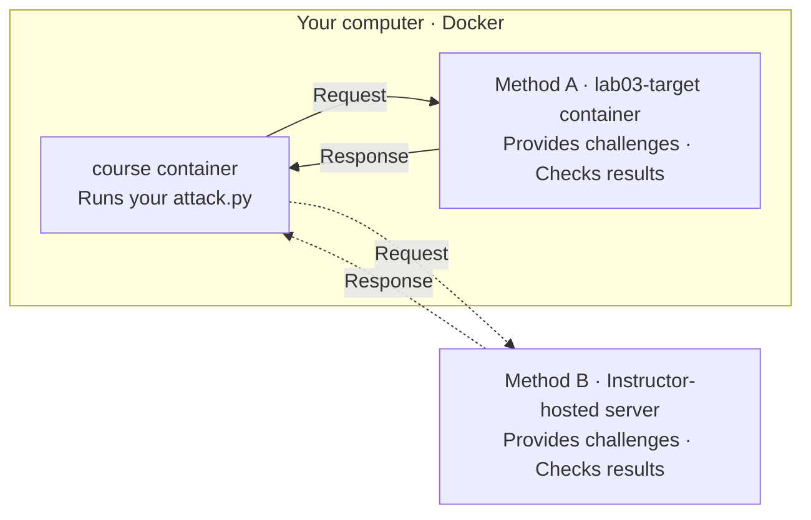

# Lab03: Public-Key Cryptography — CTF Laboratory

[한국어](../../../labs/lab03/README.md) | **English**

## Learning Objectives

Implement the mathematics of public-key cryptography and measure its cost. Investigate
predictable randomness, weak RSA parameters, textbook RSA malleability, signature
verification errors, and CRT faults, then validate secure API usage and countermeasures.
Complete exactly these eight Parts.

| Part | Title | Completion objective |
|---|---|---|
| [Part01](part01/README.md) | Modular Exponentiation and Primality Testing | Implementation, performance, and a 128-bit composite |
| [Part02](part02/README.md) | Predictable Key Recovery and Secure Random Generation | PDF recovery and RNG error handling |
| [Part03](part03/README.md) | RSA Key Generation, Encryption, and CRT | C BIGNUM RSA and CRT optimization |
| [Part04](part04/README.md) | RSA Factorization Attack | Factor a weak modulus and decrypt |
| [Part05](part05/README.md) | RSA Low Public Exponent Attack | Exact integer cube root and attack conditions |
| [Part06](part06/README.md) | Textbook RSA Malleability and RSA-OAEP | Server exploitation and OAEP comparison |
| [Part07](part07/README.md) | RSA-PSS Signatures and Secure Verification | Accept valid signatures and reject errors |
| [Part08](part08/README.md) | RSA-CRT Fault Attack | Fresh-message signing and output verification |

## Challenge Scenario

Each Part audits an independent device or service. Implementation challenges require
the specified operations and performance as well as correct results. Use only the
supplied public data and explicitly authorized laboratory targets for attacks.

## Provided Materials

Each `partNN/` contains `README.md`, `starter/`, `data/`, and `tests/`.
Korean and English documents share the same code and data. Instructor solutions,
generators, and grading materials are excluded from the student release.
Use [REPORT_TEMPLATE.md](REPORT_TEMPLATE.md) for your report.

## Tasks

Implement each Part's TODOs, run its public checks, and answer its Checkpoint Questions.
Use Python 3 for experiments and GCC/OpenSSL for C implementations. Submit source,
reproducible measurements, attack evidence, and countermeasure checks. Public checks
provide local feedback; they do not determine the final grade.

<a id="setup"></a>

## How to Run

### 1 Download the latest materials

Run in a **host terminal**. Adjust the `cd` path to where you downloaded the repository.

```console
cd modern-cryptography-2026
git pull --ff-only origin main
```

### 2 Start the shared environment

Start Docker, then run in a **host terminal at the repository root**.

| Parts | Required Docker images | How they are obtained |
|---|---|---|
| Parts 01–05 and 07 | `modern-cryptography-2026` (`course`) | Built locally from this repository by the command below |
| Parts 06 and 08 with a local target | `course` + `ghcr.io/wonsuk-emsec/modern-cryptography-2026-lab03-target:2026-lab03-v1` (`lab03-target`) | Build `course` locally; the [server setup](#server-setup) command automatically pulls the target image when needed |
| Parts 06 and 08 with an instructor-hosted server | `course` | No local target image needed |

```console
docker compose -f docker/compose.yml build course
docker compose -f docker/compose.yml up -d course
docker compose -f docker/compose.yml exec course bash
```

The last command opens a **container terminal**. Verify the environment there:

```console
cd /workspace
python3 -c "import Crypto, cryptography; print('Lab03 Python imports: OK')"
gcc --version
openssl version
make -C labs/lab03 test
```

`make test` checks materials and tools; it should report `OK` even before you finish the implementations.

### 3 Implement and check each Part

- Start with [Part01](part01/README.md), read each Part's README, and implement its `starter/` TODOs.
- Follow that Part for compilation, individual experiments, and expected output.
- **Complete the [server setup](#server-setup) before checking Parts06 and08.**

Check only the Part you have implemented in the **course container terminal**. For Part01:

```console
cd /workspace
python3 -m labs.lab03.check --part 1
```

Replace the number after `--part` with the Part number, from 1 to 8. Checks are expected to fail while TODOs remain.
`make -C labs/lab03 grade PART=1` runs the same checker.

<a id="server-setup"></a>

### 4 Prepare the server for Parts06 and08

Your code in `course` sends requests to a server that provides challenges and checks results.
**Choose just one connection method below.**



1) **Method A: Run the server on your computer**

    Run in a **new host terminal at the repository root**. Leave your existing `course` terminal open.

    ```console
    docker compose -f docker/compose.yml --profile lab03 up -d --wait course lab03-target
    docker compose -f docker/compose.yml --profile lab03 ps
    ```

    The server is ready when `lab03-target` shows `healthy`. The code uses the default address
    `http://lab03-target:8080`; you do not need to open it in a browser.
    If the image download reports `denied` or `manifest unknown`, contact your instructor.
    You can continue Parts01–05 and Part07 meanwhile.

2) **Method B: Use the instructor-hosted server**

    Without starting a local server, set the actual supplied address in your **existing course terminal**:

    ```console
    export LAB03_TARGET_URL=https://INSTRUCTOR-PROVIDED-HOST
    ```

    Set it again in each new `course` terminal. To switch to Method A, run `unset LAB03_TARGET_URL`.


#### Check the connection

For either method, check in the **course terminal**:

```console
cd /workspace
python3 -c "from labs.lab03.common.service_client import TargetClient; print(TargetClient().request('GET', '/health'))"
```

Expected response:

```text
{'ok': True, 'service': 'lab03-target'}
```

Once connected, implement and check [Part06](part06/README.md) or [Part08](part08/README.md).
For connection errors, check the local server's `healthy` status or the supplied address.
Inspect local server logs in a **host terminal at the repository root**:

```console
docker compose -f docker/compose.yml --profile lab03 logs --tail 30 lab03-target
```

### 5 Finish the session

Leave the **container terminal**.

```console
exit
```

When all work is finished, clean up in a **host terminal at the repository root**.

```console
docker compose -f docker/compose.yml --profile lab03 down
```

To keep using `course` and stop only the local lab server, use this command instead:

```console
docker compose -f docker/compose.yml --profile lab03 stop lab03-target
```

## Success Conditions

Completion results use `LAB03{...}`. Local checker receipts are public, nonsecret
feedback. Recovered data in Parts02,04,05 is evidence of exploitation. Final grading
uses independently generated inputs and source review; instructors assess answers to the Checkpoint Questions. Printing a known string alone cannot pass.

Users controlling local Docker can inspect images and memory. Local practice keys
and flags have no secrecy guarantee. Real grading keys and flags belong on
instructor-hosted targets or in isolated grading infrastructure. OAEP does not
authenticate senders or authorize transfers. The Part08 countermeasure addresses
the laboratory's single-CRT-branch fault model.

## Submission Requirements

The [report template](REPORT_TEMPLATE.md) summarizes the required contents for
each Part. Include **answers to every Checkpoint Question in each Part's README**
in the corresponding Part of your report, in addition to the template items.
Submit the source files, commands/output, recovery evidence or server completion
result required by each Part together with the report. Include operation counts, repetitions, medians, relative speed, and execution
environment for Parts01/03. Include the recovered PDF and SHA-256 for Part02 and
positive/error verification results for Part07. Do not submit server keys or
instructor files unless requested by staff.
