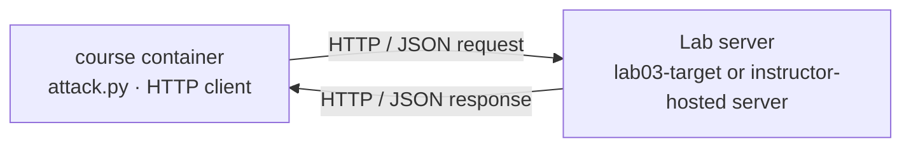

# Part06: Textbook RSA Malleability and RSA-OAEP

[한국어](../../../../labs/lab03/part06/README.md) | **English**

A transfer service encrypts integer amounts with textbook RSA. Modify a ciphertext to make
it process **twice the amount**, without knowing the original amount. Apply the same modification
to RSA-OAEP and compare the results.

## 1. Learning Objectives

1. **Modify ciphertext:** use textbook RSA's multiplicative relation.
2. **Compare OAEP:** confirm acceptance of a normal ciphertext and rejection of its modification.
3. **Check server results:** complete all experiments in one session and inspect the server's decision.



Use one lab server. Follow the [shared server setup](../README.md#server-setup) for its address and connection check.

## 2. Provided Materials

- [starter/attack.py](../../../../labs/lab03/part06/starter/attack.py): TODOs for modification, OAEP encryption, and requests.
- [data/protocol.json](../../../../labs/lab03/part06/data/protocol.json): public protocol and limits.
- [tests/check.py](../../../../labs/lab03/part06/tests/check.py): checks completion of a fresh server-created session.
- [Shared HTTP client](../../../../labs/lab03/common/service_client.py): `TargetClient.request(method, path, payload=None)`.
- `GET /part06/challenge`: issues fresh public challenge data and the public key at runtime.

**Edit `starter/attack.py`.** Public challenge values are issued by the server at runtime.

## 3. Tasks

### Stage 1: Implement ciphertext modification and OAEP encryption

> **Ciphertext modification**
>
> $$c'=c\cdot r^e\bmod n$$
>
> Decryption yields r times the original plaintext (mod n). This lab uses r=2.

- **`modify_ciphertext(ciphertext, multiplier, n, e)`: multiplicative modification**

    Implement this in `starter/attack.py`. Apply the relation above and return an integer in `[0,n)`.
    You do not need to recover the original amount or private key.

- **`encrypt_oaep(amount, n, e)`: generate a valid OAEP ciphertext**

    Implement this in the same file. Encrypt the **ASCII bytes** of `amount` using public key n/e,
    then return the ciphertext as a big-endian integer. For example, encrypt the string `"100"` as `b"100"`.
    Use **RSA-2048, SHA-256, MGF1-SHA-256, and an empty label**. Explicitly configure the hash, MGF1, and label.

### Stage 2: Send requests and check results

- **`attack(client, challenge)`: perform three experiments**

    The checker passes a fresh session and public data in `challenge`.
    Read `public_key.n`, `public_key.e`, `ciphertext`, `multiplier`, and `oaep_amount` as in the starter.
    Use `client.request(method, path, payload)` for these requests in the same session:

    1. Submit the modified textbook RSA ciphertext to `/part06/transfer`.
    2. Submit the valid OAEP ciphertext to `/part06/oaep/transfer` with `stage:"normal"`.
    3. Modify **that exact OAEP ciphertext** by the same multiplier and submit with `stage:"tampered"`.

    The normal OAEP request must succeed before the modified request. Do not encrypt a new ciphertext
    for modification or substitute arbitrary broken ciphertext. Check each response's `accepted` and `status`.
    The function need not return a value; the checker then queries `/part06/result` for completion.
    Do not contact the server when the module is imported.

<details>
<summary>Request/response fields and limits</summary>

Public integers are decimal strings without leading zeroes and must satisfy `0 <= value < n`.
Sessions are 32 lowercase hexadecimal characters and expire after 30 minutes. JSON requests
are limited to 16 KiB. The original amount, private key, and instructor grading flag are not provided.

Request and response schemas follow. Extra JSON fields are rejected. The common response
field `ok` describes request processing; `accepted` describes application acceptance.

| Method / path | Request | Successful or application result |
|---|---|---|
| `GET /part06/challenge` | None | `session`, `public_key:{n,e}`, `ciphertext`, `multiplier:"2"`, `oaep_amount:"100"`, `oaep:{hash,mgf1_hash,label}`, `expires_in` |
| `POST /part06/transfer` | `{session,ciphertext}` | `accepted`, `status:MODIFIED_TRANSFER_ACCEPTED` or `OBJECTIVE_NOT_MET` |
| `POST /part06/oaep/transfer` | `{session,ciphertext,stage:"normal"}` | `accepted`, `status:NORMAL_TRANSFER_ACCEPTED` or `OAEP_REJECTED` |
| `POST /part06/oaep/transfer` | `{session,ciphertext,stage:"tampered"}` | `accepted:false`, `status:OAEP_REJECTED`; `OBJECTIVE_NOT_MET` for a different modification |
| `GET /part06/result?session=...` | This session | `complete`, `checks:{textbook_modified,oaep_normal,oaep_tamper_rejected}`; `flag` only when complete |

HTTP errors have `{ok:false,error:...}`. Invalid input returns 400, unknown or expired sessions
404, replayed completed steps or incorrect ordering 409, and oversized requests 413. Start a
fresh session on each run. The service provides no arbitrary plaintext decryption interface.

</details>

## 4. How to Run

Complete the [shared server setup](../README.md#server-setup), then run in the **course container terminal**.
If the server is already connected, continue here.

```console
cd /workspace/labs/lab03/part06
python3 tests/check.py
```

Failure is expected while TODOs remain: the output starts with `Part06 incomplete:` and includes error details.
With a working server connection, the incomplete starter fails at a `NotImplementedError`.
Implement or fix the functions, then run the same command again. Each run obtains a new session.

On success, the first line is:

```text
Part06 complete: target verified all objectives
```

The next line contains the server-issued `LAB03{...}` flag. Submit it through the instructor's designated channel.

<details>
<summary>Additional options and troubleshooting</summary>

`python3 starter/attack.py` runs the same checks. Use `--solution PATH` for another implementation.
Select an instructor-hosted server with `--url URL` or `LAB03_TARGET_URL`.
The submitted client has a 60-second limit. For connection errors, logs, or shutdown, follow the
[shared guide](../README.md#server-setup).

</details>

## 5. Success Conditions

- The server accepts the specified modification of the session's textbook RSA ciphertext.
- The normal OAEP transfer succeeds.
- The server rejects the specified multiplicative modification of that same OAEP ciphertext.

All three conditions must hold in the same session for a flag. OAEP rejection does not establish sender authentication or transfer authorization.

## 6. Submission Requirements

Submit completed `attack.py` and Part06 of the [report template](../REPORT_TEMPLATE.md).
Include each stage's request/response records, the server flag, and answers to every Checkpoint Question below.
No private key is needed. Submit the flag through the instructor's designated channel.

## 7. Checkpoint Questions

1. Why can you double an unknown amount? Why are amounts bounded to avoid modular wraparound?
2. Why must normal OAEP operation succeed before testing modification?
3. Does rejection of the modified OAEP ciphertext authenticate the sender or authorize a transfer?
4. Why does textbook success alone not release the flag?
