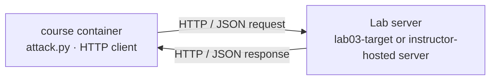

# Part08: RSA-CRT Fault Attack

[한국어](../../../../labs/lab03/part08/README.md) | **English**

A device computing RSA signatures with CRT has an error in one branch.
Recover the private exponent from the faulty signature and prove recovery by signing a fresh value
issued by the server. Then check whether verifying signatures before release blocks the same fault.

## 1. Learning Objectives

1. **Recover the private exponent:** find a factor of n from a fault in one CRT branch.
2. **Generate a fresh signature:** sign a new value using the recovered exponent.
3. **Check the countermeasure:** block faulty signatures while allowing valid ones.

This Part signs integer representatives directly with raw RSA. Distinguish it from Part07's RSA-PSS.



Use one lab server. Follow the [shared server setup](../README.md#server-setup) for its address and connection check.

## 2. Provided Materials

- [starter/attack.py](../../../../labs/lab03/part08/starter/attack.py): TODOs for private-exponent recovery, fresh signing, and requests.
- [data/protocol.json](../../../../labs/lab03/part08/data/protocol.json): public protocol and limits.
- [tests/check.py](../../../../labs/lab03/part08/tests/check.py): checks actual server completion state.
- [Shared HTTP client](../../../../labs/lab03/common/service_client.py): `TargetClient.request(method, path, payload=None)`.
- `GET /part08/challenge`: a fresh session, RSA-2048 public key, and `mu`.

**Edit `starter/attack.py`.** Public challenge values are issued by the server at runtime.

## 3. Tasks

### Stage 1: Recover the private exponent from a faulty signature

> **Factor recovery**
>
> $$v=s_{faulty}^{e}\bmod n,\qquad p=\gcd(v-\mu,n)$$
>
> Check whether this GCD reveals a factor of n when only one CRT branch is faulty.

- **`recover_private_exponent(n, e, mu, faulty_signature)`: recover the private exponent**

    Implement this in `starter/attack.py`. Obtain a factor using the formula above and check `1 < p < n`.
    Calculate the other factor q and phi, then return the private exponent d, the inverse of e, as an integer.
    The fault affects only one CRT branch; the other residue remains correct.

- **`forge_signature(mu2, d, n)`: sign a fresh value**

    Implement this in the same file. Use recovered d to calculate the raw RSA signature of `mu2` and return an integer.
    Verifying the signature with the public key must recover `mu2`.
    Sign the **fresh, unpredictable `mu2` issued afterward** by the server, not the original `mu`.

### Stage 2: Check server verification and countermeasures

- **`attack(client, challenge)`: prove recovery and test the protected path**

    The checker passes a fresh session, public key, and `mu`. The starter already calls `/part08/sign`
    to obtain the faulty signature and `mu2`. That request is allowed only once per session.
    Continue with these actions in the same session:

    1. Submit a signature of fresh `mu2` to `/part08/verify` and check acceptance.
    2. Send `fault:true` to `/part08/secure-sign`; check rejection and the **absence of a `signature` field**.
    3. With `fault:false`, obtain a valid signature and verify with the public key that it represents **the original `mu`**.

    `fault` is a boolean, not a string (`True`/`False` in Python).
    The protected path signs only the original `mu`, never `mu2` or arbitrary values.
    Check every response. The function need not return a value;
    the checker then queries `/part08/result` for completion. Do not contact the server on module import.

<details>
<summary>Request/response fields and limits</summary>

No private key or factors are provided. Public integers are canonical decimal strings without
leading zeroes, satisfying `0 <= value < n`. Sessions are 32 lowercase hexadecimal characters,
valid for 30 minutes. The request limit is 16 KiB; the server socket timeout is 5 seconds.

Field sets must match exactly; extra JSON fields are rejected. The common response field
`ok` describes request processing; `accepted` describes application acceptance.

| Method / path | Request | Successful or application result |
|---|---|---|
| `GET /part08/challenge` | None | `session`, `public_key:{n,e}`, `mu`, `primitive`, `expires_in` |
| `POST /part08/sign` | `{session}` | `faulty_signature`, `mu2`; once per session |
| `POST /part08/verify` | `{session,signature}` | `accepted`, `status:FRESH_SIGNATURE_ACCEPTED` or `INVALID_FRESH_SIGNATURE` |
| `POST /part08/secure-sign` | `{session,fault:true}` | `accepted:false`, `status:FAULT_DETECTED`; **no signature field** |
| `POST /part08/secure-sign` | `{session,fault:false}` | `accepted:true`, `status:SIGNATURE_VERIFIED`, `signature` |
| `GET /part08/result?session=...` | This session | `complete`, `checks:{fresh_signature_valid,fault_blocked,normal_signature_valid}`; `flag` only when complete |

`fault` must be a JSON boolean, not a string. HTTP errors have `{ok:false,error:...}`.
Invalid input returns 400, unknown or expired sessions 404, completed-step replay or incorrect
ordering 409, and oversized requests 413. New sessions use fresh `mu` and `mu2` values.

</details>

## 4. How to Run

Complete the [shared server setup](../README.md#server-setup), then run in the **course container terminal**.
If the server is already connected, continue here.

```console
cd /workspace/labs/lab03/part08
python3 tests/check.py
```

Failure is expected while TODOs remain: the output starts with `Part08 incomplete:` and includes error details.
With a working server connection, the incomplete starter fails at a `NotImplementedError`.
Implement or fix the functions, then run the same command again. Each run obtains a new session.

On success, the first line is:

```text
Part08 complete: target verified all objectives
```

The next line contains the server-issued `LAB03{...}` flag. Submit it through the instructor's designated channel.

<details>
<summary>Additional options and troubleshooting</summary>

`python3 starter/attack.py` runs the same checks. Use `--solution PATH` for another implementation.
Select an instructor-hosted server with `--url URL` or `LAB03_TARGET_URL`.
The submitted client has a 60-second limit. For connection errors, logs, or shutdown, follow the
[shared guide](../README.md#server-setup).

</details>

## 5. Success Conditions

- The server verifies a valid signature of fresh `mu2`.
- With a fault, the protected path rejects the request and returns no signature field.
- Without a fault, the protected path returns a signature of the original `mu` that verifies with the public key.

All three conditions must hold in the same session for a flag. This countermeasure is evaluated against a fault in one CRT branch, not every possible physical fault attack.

## 6. Submission Requirements

Submit completed `attack.py` and Part08 of the [report template](../REPORT_TEMPLATE.md).
Include factor recovery and private-exponent derivation, public-key verification of the fresh signature,
fault/no-fault request/response records, the server flag, and answers to every Checkpoint Question below.
Submit flags through the instructor's designated channel; do not publish another session's private key.

## 7. Checkpoint Questions

1. Why does the GCD reveal a factor when just one CRT branch is faulty?
2. Why require a signature of fresh `mu2` instead of the original representative?
3. Why must the no-fault path also succeed?
4. Why does output verification stop leakage in this model, and why is that not proof against
   every physical fault attack?
