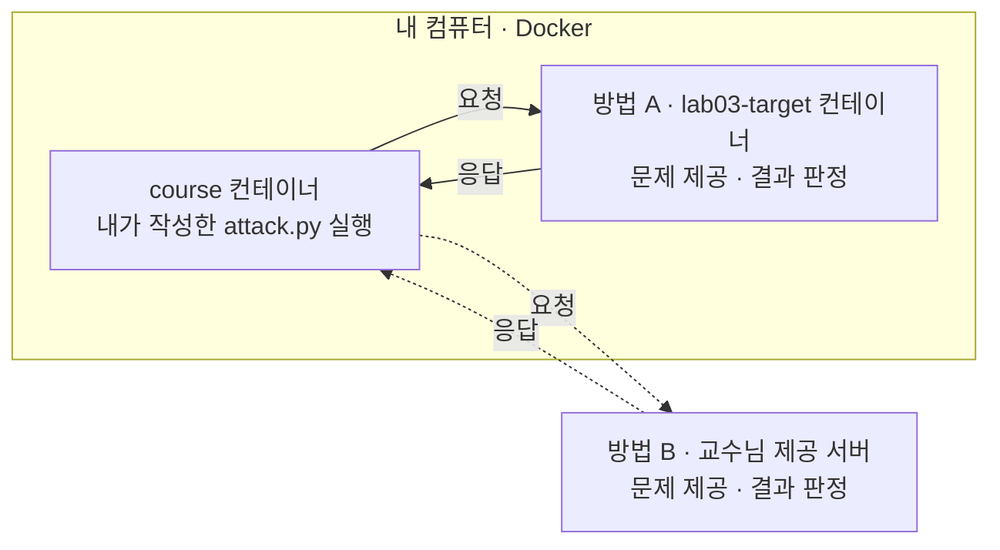

# Lab03: 공개키 암호 — CTF 실습

**한국어** | [English](../../en/labs/lab03/README.md)

## 학습 목표

공개키 암호의 수학적 연산을 구현하고 성능을 측정합니다. 취약한 난수 생성,
작은 RSA 매개변수, 교과서 RSA의 가변성, 서명 검증 오류와 CRT 결함을 실험한 뒤
안전한 API 사용 및 대응책을 검증합니다. 정확히 아래 여덟 Part를 수행합니다.

| Part | 주제 | 완료 목표 |
|---|---|---|
| [Part01](part01/README.md) | Modular Exponentiation and Primality Testing | 구현·성능·128비트 합성수 검증 |
| [Part02](part02/README.md) | Predictable Key Recovery and Secure Random Generation | PDF 복구와 RNG 오류 처리 |
| [Part03](part03/README.md) | RSA Key Generation, Encryption, and CRT | C BIGNUM RSA와 CRT 최적화 |
| [Part04](part04/README.md) | RSA Factorization Attack | 약한 모듈러스 인수분해 및 복호화 |
| [Part05](part05/README.md) | RSA Low Public Exponent Attack | 정확한 정수 세제곱근과 공격 조건 |
| [Part06](part06/README.md) | Textbook RSA Malleability and RSA-OAEP | 서버 공격과 OAEP 비교 |
| [Part07](part07/README.md) | RSA-PSS Signatures and Secure Verification | 정상 서명 수락과 오류 시 거부 |
| [Part08](part08/README.md) | RSA-CRT Fault Attack | 새 메시지 서명과 결과 검증 대응책 |

## 챌린지 시나리오

각 Part는 독립된 장치나 서비스를 감사하는 CTF입니다. 구현 문제는 올바른 결과뿐
아니라 지정된 연산과 성능 조건을 만족해야 합니다. 공격 문제는 제공된 공개 데이터와
명시적으로 허가된 실습 대상만 사용합니다.

## 제공 자료

각 `partNN/`에는 `README.md`, `starter/`, `data/`, `tests/`가 있습니다.
문서는 한국어·영어로 제공되며 코드와 데이터는 공통입니다.
교수용 해답, 생성기와 평가 자료는 학생 배포본에 포함되지 않습니다.
보고서 양식은 [REPORT_TEMPLATE.md](REPORT_TEMPLATE.md)입니다.

## 과제

각 Part의 TODO를 구현한 뒤 공개 검사를 실행하고 Checkpoint Questions에 답하세요. Python 실험에는
Python 3, C 구현에는 GCC와 OpenSSL을 사용합니다. 코드, 재현 가능한 측정 결과,
공격 증거와 대응책 검증을 제출합니다. 공개 검사는 로컬 피드백이며 최종 점수가 아닙니다.

<a id="setup"></a>

## 실행 방법

### 1. 최신 실습 자료 받기

**호스트 터미널**에서 실행하세요. `cd` 경로는 저장소를 내려받은 위치에 맞추세요.

```console
cd modern-cryptography-2026
git pull --ff-only origin main
```

### 2. 공통 실습 환경 시작하기

Docker를 실행한 뒤 **호스트 터미널의 저장소 루트**에서 실행하세요.

```console
docker compose -f docker/compose.yml build course
docker compose -f docker/compose.yml up -d course
docker compose -f docker/compose.yml exec course bash
```

마지막 명령을 실행하면 **컨테이너 터미널**로 들어갑니다. 이어서 환경을 확인하세요.

```console
cd /workspace
python3 -c "import Crypto, cryptography; print('Lab03 Python imports: OK')"
gcc --version
openssl version
make -C labs/lab03 test
```

`make test`는 자료·도구 검사이며, 구현을 완료하지 않아도 `OK`가 나와야 합니다.

### 3. 각 Part 구현하고 검사하기

- [Part01](part01/README.md)부터 각 Part의 README를 읽고 `starter/`의 TODO를 구현하세요.
- 컴파일, 개별 실험, 예상 출력은 해당 Part의 안내를 따릅니다.
- **Part06·08 검사 전에는 [서버 준비](#server-setup)를 먼저 완료하세요.**

구현한 Part만 **course 컨테이너 터미널**에서 검사하세요. 아래는 Part01 예시입니다.

```console
cd /workspace
python3 -m labs.lab03.check --part 1
```

`--part` 뒤 숫자를 1–8 중 해당 Part 번호로 바꾸세요. TODO가 남아 있다면 실패하는 것이 정상입니다.
`make -C labs/lab03 grade PART=1`로도 같은 검사를 실행할 수 있습니다.

<a id="server-setup"></a>

### 4. Part06·08 서버 준비

두 Part는 `course`에서 작성한 코드가 서버에 요청을 보내는 실습입니다.
서버는 문제를 제공하고 결과를 판정합니다. **접속 방법은 아래에서 하나만 선택하세요.**



1) **방법 A: 내 컴퓨터에서 서버 실행**

    **새 호스트 터미널의 저장소 루트**에서 실행하세요. 기존 `course` 터미널은 그대로 둡니다.

    ```console
    docker compose -f docker/compose.yml --profile lab03 up -d --wait course lab03-target
    docker compose -f docker/compose.yml --profile lab03 ps
    ```

    `lab03-target`이 `healthy`이면 준비 완료입니다. 코드는 기본 주소
    `http://lab03-target:8080`으로 접속하므로 브라우저로 열 필요는 없습니다.
    이미지 다운로드에서 `denied` 또는 `manifest unknown`이 나오면 교수님께 문의하세요.
    그동안 Part01–05와 Part07은 진행할 수 있습니다.

2) **방법 B: 교수님 제공 서버 사용**

    로컬 서버를 시작하지 않고, **기존 course 터미널**에서 실제 제공받은 주소를 설정하세요.

    ```console
    export LAB03_TARGET_URL=https://INSTRUCTOR-PROVIDED-HOST
    ```

    새 `course` 터미널에서는 다시 설정합니다. 방법 A로 바꾸려면 `unset LAB03_TARGET_URL`을 실행하세요.

#### 연결 확인

어느 방법이든 **course 컨테이너 터미널**에서 실행하세요.

```console
cd /workspace
python3 -c "from labs.lab03.common.service_client import TargetClient; print(TargetClient().request('GET', '/health'))"
```

예상 응답:

```text
{'ok': True, 'service': 'lab03-target'}
```

연결되면 [Part06](part06/README.md) 또는 [Part08](part08/README.md)의 구현·검사를 진행하세요.
연결 오류가 나면 로컬 서버의 `healthy` 상태 또는 제공받은 주소를 확인하세요.
로컬 서버 로그는 **호스트 터미널의 저장소 루트**에서 확인합니다.

```console
docker compose -f docker/compose.yml --profile lab03 logs --tail 30 lab03-target
```

### 5. 실습 종료하기

컨테이너 터미널에서 나옵니다.

```console
exit
```

모든 실습을 마쳤다면 **호스트 터미널의 저장소 루트**에서 정리합니다.

```console
docker compose -f docker/compose.yml --profile lab03 down
```

`course`는 계속 사용하고 로컬 서버만 중지하려면 대신 실행하세요.

```console
docker compose -f docker/compose.yml --profile lab03 stop lab03-target
```

## 성공 조건

완료 표식은 `LAB03{...}` 형식입니다. 로컬 검사 표식은 공개된 비밀이 아닌 피드백입니다.
Part02·04·05의 복구한 데이터는 공격 성공 증거입니다. 최종 평가는 독립적으로 생성된
입력과 소스 검토를 사용하며, Checkpoint Questions 답변은 교수자가 평가합니다. 정해진 문자열을 출력하는
것만으로는 통과하지 않습니다.

로컬 Docker를 제어하는 사용자는 이미지와 메모리를 조사할 수 있습니다. 로컬 연습 키와
플래그의 비밀성은 보장하지 않습니다. 실제 평가용 키·플래그는 교수자 관리 서버나 격리된
평가 환경에서만 사용합니다. OAEP는 송신자 인증이나 송금 권한 검사를 제공하지 않으며,
Part08 대응책은 실습의 단일 CRT 분기 결함 모델을 대상으로 합니다.

## 제출 요구 사항

[제출 보고서 양식](REPORT_TEMPLATE.md)은 각 Part의 필수 포함 내용을 요약한 것입니다.
양식의 항목과 함께 **각 Part README의 Checkpoint Questions 전체 답변**을 해당 Part의 보고서에
포함하세요. 보고서와 함께 각 Part에서 요구하는 구현 소스, 실행 명령·출력,
복구 증거 또는 서버 완료 결과도 제출합니다.
Part01·03에는 연산 수, 반복 수, 중앙값, 상대 속도와 실행 환경을 포함하세요.
Part02의 복구 PDF와 SHA-256, Part07의 정상·오류 검증 결과도 포함합니다.
교수자가 요청하지 않은 서버 키나 교수용 파일은 제출하지 마세요.
