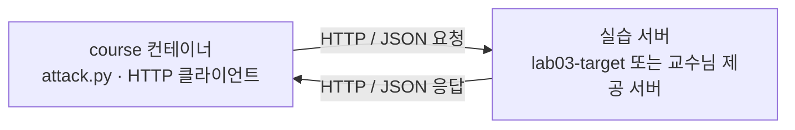

# Part06: Textbook RSA Malleability and RSA-OAEP

**한국어** | [English](../../../en/labs/lab03/part06/README.md)

송금 서비스가 정수 금액을 textbook RSA로 암호화했습니다. 원래 금액을 모르는 상태에서
암호문을 바꾸어 **2배의 금액**이 처리되도록 해보세요. 같은 변형을 RSA-OAEP에도 적용해 결과를 비교합니다.

## 1. 학습 목표

1. **암호문 변형:** textbook RSA의 곱셈 관계를 이용합니다.
2. **OAEP 비교:** 정상 암호문은 허용되고 변형한 암호문은 거부되는지 확인합니다.
3. **서버 결과 확인:** 같은 세션에서 모든 실험을 완료하고 서버의 판정을 확인합니다.



실습 서버는 두 방식 중 하나만 사용합니다. 주소 설정과 연결 확인은 [공통 서버 안내](../README.md#server-setup)를 따르세요.

## 2. 제공 자료

- [starter/attack.py](starter/attack.py): 암호문 수정, OAEP 암호화, 요청 전송 TODO.
- [data/protocol.json](data/protocol.json): 공개 프로토콜과 제한 사항.
- [tests/check.py](tests/check.py): 서버가 생성한 새 세션의 완료 여부 검사.
- [공통 HTTP 클라이언트](../common/service_client.py): `TargetClient.request(method, path, payload=None)`.
- `GET /part06/challenge`: 실행 시 공개키와 새로운 공개 도전 데이터를 제공합니다.

**수정할 파일은 `starter/attack.py`입니다.** 실제 문제 값은 실행 시 서버에서 받습니다.

## 3. 수행 과제

### 1단계: 암호문 변형과 OAEP 암호화 구현하기

> **암호문 변형**
>
> $$c'=c\cdot r^e\bmod n$$
>
> 복호화하면 원래 평문의 r배가 됩니다(mod n). 이 실습의 r은 2입니다.

- **`modify_ciphertext(ciphertext, multiplier, n, e)`: 배수 변형**

    `starter/attack.py`에 구현하세요. 위 관계로 암호문을 변형하고 `[0,n)` 범위의 정수를 반환합니다.
    원래 금액이나 비밀키를 알아낼 필요는 없습니다.

- **`encrypt_oaep(amount, n, e)`: 정상 OAEP 암호문 생성**

    같은 파일에 구현하세요. 공개키 n·e로 `amount`의 **ASCII 바이트**를 암호화하고,
    결과 암호문을 big-endian 정수로 반환합니다. 예를 들어 문자열 `"100"`은 `b"100"`으로 암호화합니다.
    설정은 **RSA-2048, SHA-256, MGF1-SHA-256, 빈 label**입니다. 해시·MGF1·label을 명시하세요.

### 2단계: 서버에 요청하고 결과 확인하기

- **`attack(client, challenge)`: 세 실험 수행**

    검사기가 새 세션과 공개 데이터를 `challenge`로 전달합니다.
    제공된 코드처럼 `public_key.n`, `public_key.e`, `ciphertext`, `multiplier`, `oaep_amount`를 읽으세요.
    `client.request(method, path, payload)`로 다음 요청을 같은 세션에서 수행합니다.

    1. 변형한 textbook RSA 암호문을 `/part06/transfer`에 제출합니다.
    2. 정상 OAEP 암호문을 `/part06/oaep/transfer`에 `stage:"normal"`로 제출합니다.
    3. **그 동일한 OAEP 암호문**을 같은 배수로 변형해 `stage:"tampered"`로 제출합니다.

    정상 OAEP 요청이 성공한 뒤 변형 요청을 보내세요. 변형용 암호문을 새로 암호화하거나
    임의의 깨진 암호문으로 바꾸면 안 됩니다. 각 응답의 `accepted`와 `status`를 확인하세요.
    함수는 별도 값을 반환할 필요가 없으며, 검사기가 마지막에 `/part06/result`의 완료 상태를 확인합니다.
    모듈 import 시 서버에 요청을 보내지 마세요.

<details>
<summary>요청·응답 필드와 제한 사항</summary>

공개 정수는 선행 0 없는 10진 문자열이며 `0 <= 값 < n`이어야 합니다. 세션은
32자리 소문자 16진수이며 30분 후 만료합니다. JSON 요청은 16 KiB 이하입니다.
원래 송금 금액, 개인키, 교수용 채점 플래그는 제공하지 않습니다.

요청·응답 스키마는 다음과 같습니다. 아래 JSON 필드 외 추가 필드는 거절됩니다.
각 응답의 공통 `ok`는 요청 처리 여부이며, 송금 승인 여부는 `accepted`입니다.

| 메서드 / 경로 | 요청 | 성공 또는 애플리케이션 결과 |
|---|---|---|
| `GET /part06/challenge` | 없음 | `session`, `public_key:{n,e}`, `ciphertext`, `multiplier:"2"`, `oaep_amount:"100"`, `oaep:{hash,mgf1_hash,label}`, `expires_in` |
| `POST /part06/transfer` | `{session,ciphertext}` | `accepted`, `status:MODIFIED_TRANSFER_ACCEPTED` 또는 `OBJECTIVE_NOT_MET` |
| `POST /part06/oaep/transfer` | `{session,ciphertext,stage:"normal"}` | `accepted`, `status:NORMAL_TRANSFER_ACCEPTED` 또는 `OAEP_REJECTED` |
| `POST /part06/oaep/transfer` | `{session,ciphertext,stage:"tampered"}` | `accepted:false`, `status:OAEP_REJECTED`; 지정 변형이 아니면 `OBJECTIVE_NOT_MET` |
| `GET /part06/result?session=...` | 해당 세션 | `complete`, `checks:{textbook_modified,oaep_normal,oaep_tamper_rejected}`; 완료한 경우에만 `flag` |

HTTP 오류는 `{ok:false,error:...}`입니다. 잘못된 입력은 400, 알 수 없거나 만료된
세션은 404, 이미 완료된 단계의 재전송 또는 순서 오류는 409, 큰 요청은 413입니다.
매 실행마다 새 세션을 사용하세요. 서비스는 임의 복호화 결과를 제공하지 않습니다.

</details>

## 4. 실행 방법

[공통 서버 준비](../README.md#server-setup)를 마친 뒤 **course 컨테이너 터미널**에서 실행하세요.
이미 서버 연결을 확인했다면 바로 진행합니다.

```console
cd /workspace/labs/lab03/part06
python3 tests/check.py
```

TODO가 남아 있다면 실패하는 것이 정상입니다. `Part06 incomplete:` 뒤에 오류 내용이 표시됩니다.
서버에 정상 연결된 미완성 starter에서는 `NotImplementedError`가 발생합니다.
함수를 구현하거나 수정한 뒤 같은 명령으로 다시 검사하세요. 실행할 때마다 새 세션을 받습니다.

성공 시 첫 줄은 다음과 같습니다.

```text
Part06 complete: target verified all objectives
```

다음 줄에는 서버가 발급한 `LAB03{...}` 플래그가 표시됩니다. 플래그는 강사 지정 채널로 제출하세요.

<details>
<summary>추가 옵션과 오류 확인</summary>

`python3 starter/attack.py`로 실행해도 같은 검사를 수행합니다. 다른 구현은 `--solution PATH`로 지정하세요.
교수님 서버 주소는 `--url URL` 또는 `LAB03_TARGET_URL`로 설정합니다.
클라이언트 실행 제한은 60초입니다. 연결 오류·로그 확인·종료는 [공통 안내](../README.md#server-setup)를 따르세요.

</details>

## 5. 성공 조건

- 해당 세션의 textbook RSA 암호문을 지정된 배수로 변형한 요청이 승인됩니다.
- 정상 OAEP 송금 요청이 승인됩니다.
- 그 동일한 OAEP 암호문을 지정된 배수로 변형한 요청이 거부됩니다.

같은 세션에서 세 조건을 모두 만족해야 플래그를 받습니다.
OAEP 변형 거부가 송신자 인증이나 송금 권한을 보장하는 것은 아닙니다.

## 6. 제출 항목

완성한 `attack.py`와 [보고서 양식](../REPORT_TEMPLATE.md)의 Part06를 작성해 제출하세요.
각 단계의 요청·응답 기록, 서버 플래그와 아래 Checkpoint Questions 전체 답변을 포함하세요.
개인키는 제출할 필요가 없으며, 플래그는 강사 지정 채널로 제출하세요.

## 7. Checkpoint Questions

1. 원래 금액을 몰라도 정확히 2배가 되는 이유는 무엇인가요? 모듈러 감김이 없도록
   금액을 작게 제한한 이유는 무엇인가요?
2. 정상 OAEP 요청의 성공을 먼저 확인해야 하는 이유는 무엇인가요?
3. OAEP 암호문 변형이 거절되었다는 사실이 송금자의 인증이나 송금 권한을 보장하나요?
4. textbook 단계의 성공만으로 플래그를 주지 않는 이유는 무엇인가요?
