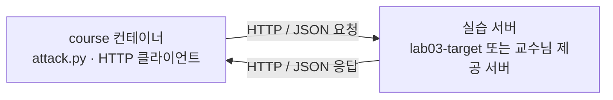

# Part08: RSA-CRT Fault Attack

**한국어** | [English](../../../en/labs/lab03/part08/README.md)

CRT로 RSA 서명을 계산하는 장치에서 한쪽 계산 결과에 오류가 발생했습니다.
이 결함 서명으로 비밀 지수를 복구하고, 서버가 새로 주는 값에 서명해 복구를 증명하세요.
이후 서명을 내보내기 전에 검증하면 같은 결함을 차단할 수 있는지 확인합니다.

## 1. 학습 목표

1. **비밀 지수 복구:** 한 CRT 분기의 결함으로 n의 인수를 찾습니다.
2. **새 서명 생성:** 복구한 비밀 지수로 새로운 값에 서명합니다.
3. **대응책 확인:** 결함 서명은 차단하고 정상 서명은 허용하는지 확인합니다.

여기서는 정수 대표값에 직접 서명하는 raw RSA를 사용합니다. Part07의 RSA-PSS와 구분하세요.



실습 서버는 두 방식 중 하나만 사용합니다. 주소 설정과 연결 확인은 [공통 서버 안내](../README.md#server-setup)를 따르세요.

## 2. 제공 자료

- [starter/attack.py](starter/attack.py): 비밀 지수 복구, 새 서명, 검증 요청 TODO.
- [data/protocol.json](data/protocol.json): 공개 프로토콜과 제한 사항.
- [tests/check.py](tests/check.py): 서버가 판정한 실제 완료 상태 검사.
- [공통 HTTP 클라이언트](../common/service_client.py): `TargetClient.request(method, path, payload=None)`.
- `GET /part08/challenge`: 새로운 세션, RSA-2048 공개키, `mu`.

**수정할 파일은 `starter/attack.py`입니다.** 실제 문제 값은 실행 시 서버에서 받습니다.

## 3. 수행 과제

### 1단계: 결함 서명에서 비밀 지수 복구하기

> **인수 복구**
>
> $$v=s_{faulty}^{e}\bmod n,\qquad p=\gcd(v-\mu,n)$$
>
> 한 CRT 분기만 잘못되었을 때 이 최대공약수가 n의 인수를 드러내는지 확인합니다.

- **`recover_private_exponent(n, e, mu, faulty_signature)`: 비밀 지수 복구**

    `starter/attack.py`에 구현하세요. 위 식으로 인수를 구하고 `1 < p < n`인지 확인합니다.
    다른 인수 q와 phi를 계산한 뒤 e의 역원인 비밀 지수 d를 정수로 반환하세요.
    결함은 한 CRT 분기에만 적용되며 다른 분기의 값은 유지됩니다.

- **`forge_signature(mu2, d, n)`: 새 값에 서명**

    같은 파일에 구현하세요. 복구한 d로 `mu2`의 raw RSA 서명을 계산해 정수로 반환합니다.
    서명 후 공개키로 검증했을 때 원래 `mu2`가 나와야 합니다.
    서명 대상은 원래 `mu`가 아니라 서버가 이후 새로 발급하는 **예측 불가능한 `mu2`**입니다.

### 2단계: 서버 검증과 대응책 확인하기

- **`attack(client, challenge)`: 복구 증명과 보호 경로 검사**

    검사기가 새 세션과 공개키·`mu`를 전달합니다. starter에는 `/part08/sign`을 호출해
    결함 서명과 `mu2`를 받는 코드가 이미 있습니다. 이 요청은 세션당 한 번만 가능합니다.
    이어서 같은 세션에서 다음 작업을 수행하세요.

    1. 새 `mu2`의 서명을 `/part08/verify`에 제출하고 승인 여부를 확인합니다.
    2. `/part08/secure-sign`에 `fault:true`를 보내 거부되고 **`signature` 필드가 없는지** 확인합니다.
    3. `fault:false`에서는 정상 서명을 받아, 공개키로 검증한 결과가 **원래 `mu`**인지 확인합니다.

    `fault`는 문자열이 아닌 boolean입니다(Python에서는 `True`·`False`).
    보호 경로는 원래 `mu`만 서명하며 `mu2`나 임의의 값을 서명해 주지 않습니다.
    각 응답을 확인하세요. 함수는 별도 값을 반환할 필요가 없으며,
    검사기가 마지막에 `/part08/result`의 완료 상태를 확인합니다. 모듈 import 시 서버에 요청을 보내지 마세요.

<details>
<summary>요청·응답 필드와 제한 사항</summary>

개인키·인수는 제공하지 않습니다. 공개 정수는 선행 0 없는 10진 문자열이며
`0 <= 값 < n`이어야 합니다. 세션은 32자리 소문자 16진수로 30분 동안 유효합니다.
요청 제한은 16 KiB, 서버 소켓 제한 시간은 5초입니다.

필드 목록은 정확해야 하며 추가 JSON 필드는 거절됩니다. 공통 응답 `ok`는 요청 처리,
`accepted`는 애플리케이션의 승인 여부입니다.

| 메서드 / 경로 | 요청 | 성공 또는 애플리케이션 결과 |
|---|---|---|
| `GET /part08/challenge` | 없음 | `session`, `public_key:{n,e}`, `mu`, `primitive`, `expires_in` |
| `POST /part08/sign` | `{session}` | `faulty_signature`, `mu2`; 세션당 한 번 |
| `POST /part08/verify` | `{session,signature}` | `accepted`, `status:FRESH_SIGNATURE_ACCEPTED` 또는 `INVALID_FRESH_SIGNATURE` |
| `POST /part08/secure-sign` | `{session,fault:true}` | `accepted:false`, `status:FAULT_DETECTED`; **signature 필드 없음** |
| `POST /part08/secure-sign` | `{session,fault:false}` | `accepted:true`, `status:SIGNATURE_VERIFIED`, `signature` |
| `GET /part08/result?session=...` | 해당 세션 | `complete`, `checks:{fresh_signature_valid,fault_blocked,normal_signature_valid}`; 완료 시에만 `flag` |

`fault`는 문자열이 아니라 JSON boolean입니다. HTTP 오류는 `{ok:false,error:...}`입니다.
잘못된 입력은 400, 알 수 없거나 만료된 세션은 404, 완료한 단계의 재전송 또는
순서 오류는 409, 큰 요청은 413입니다. 새 세션에서는 새로운 `mu`와 `mu2`를 사용합니다.

</details>

## 4. 실행 방법

[공통 서버 준비](../README.md#server-setup)를 마친 뒤 **course 컨테이너 터미널**에서 실행하세요.
이미 서버 연결을 확인했다면 바로 진행합니다.

```console
cd /workspace/labs/lab03/part08
python3 tests/check.py
```

TODO가 남아 있다면 실패하는 것이 정상입니다. `Part08 incomplete:` 뒤에 오류 내용이 표시됩니다.
서버에 정상 연결된 미완성 starter에서는 `NotImplementedError`가 발생합니다.
함수를 구현하거나 수정한 뒤 같은 명령으로 다시 검사하세요. 실행할 때마다 새 세션을 받습니다.

성공 시 첫 줄은 다음과 같습니다.

```text
Part08 complete: target verified all objectives
```

다음 줄에는 서버가 발급한 `LAB03{...}` 플래그가 표시됩니다. 플래그는 강사 지정 채널로 제출하세요.

<details>
<summary>추가 옵션과 오류 확인</summary>

`python3 starter/attack.py`로 실행해도 같은 검사를 수행합니다. 다른 구현은 `--solution PATH`로 지정하세요.
교수님 서버 주소는 `--url URL` 또는 `LAB03_TARGET_URL`로 설정합니다.
클라이언트 실행 제한은 60초입니다. 연결 오류·로그 확인·종료는 [공통 안내](../README.md#server-setup)를 따르세요.

</details>

## 5. 성공 조건

- 서버가 새로운 `mu2`에 대한 유효한 서명을 확인합니다.
- 결함이 있으면 보호 경로가 요청을 거부하고 서명 필드를 반환하지 않습니다.
- 결함이 없으면 보호 경로가 원래 `mu`의 서명을 반환하며, 공개키 검증에 성공합니다.

같은 세션에서 세 조건을 모두 만족해야 플래그를 받습니다.
이 대응책은 한 CRT 분기의 결함을 대상으로 하며 모든 물리적 결함 공격에 대한 보안 증명은 아닙니다.

## 6. 제출 항목

완성한 `attack.py`와 [보고서 양식](../REPORT_TEMPLATE.md)의 Part08를 작성해 제출하세요.
인수 복구·개인 지수 계산 설명, 새 서명의 공개키 검증 결과, 결함/무결함 요청·응답,
서버 플래그와 아래 Checkpoint Questions 전체 답변을 포함하세요.
플래그는 강사 지정 채널로 제출하고, 다른 세션의 비밀키는 공개하지 마세요.

## 7. Checkpoint Questions

1. 한 CRT 분기만 잘못되었을 때 최대공약수에서 인수가 나타나는 이유는 무엇인가요?
2. 원래 대표값의 서명 대신 새로운 `mu2` 서명을 요구하는 이유는 무엇인가요?
3. 무결함 경로의 성공까지 확인해야 하는 이유는 무엇인가요?
4. 출력 검증이 이 결함 모델의 누출을 막는 이유와, 모든 물리적 결함 공격에 대한
   보안 증명을 의미하지 않는 이유를 설명하세요.
